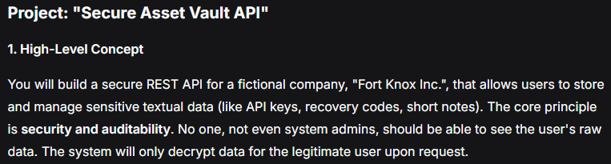
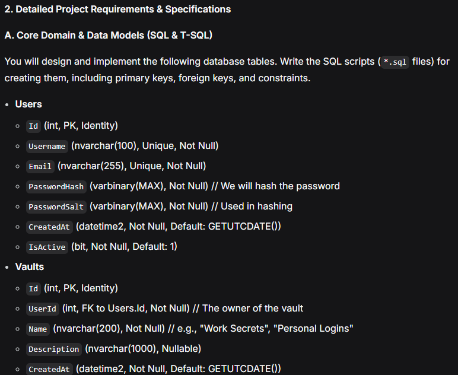
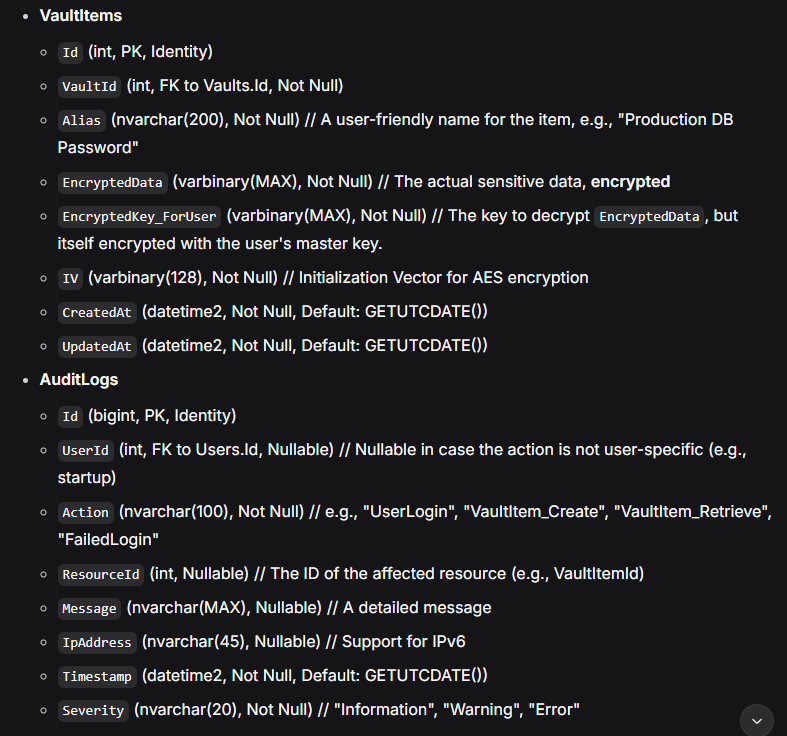
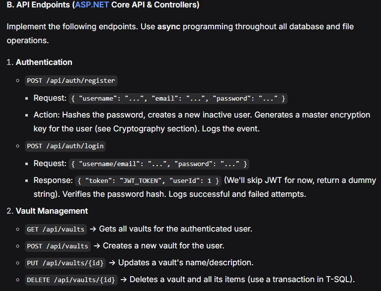
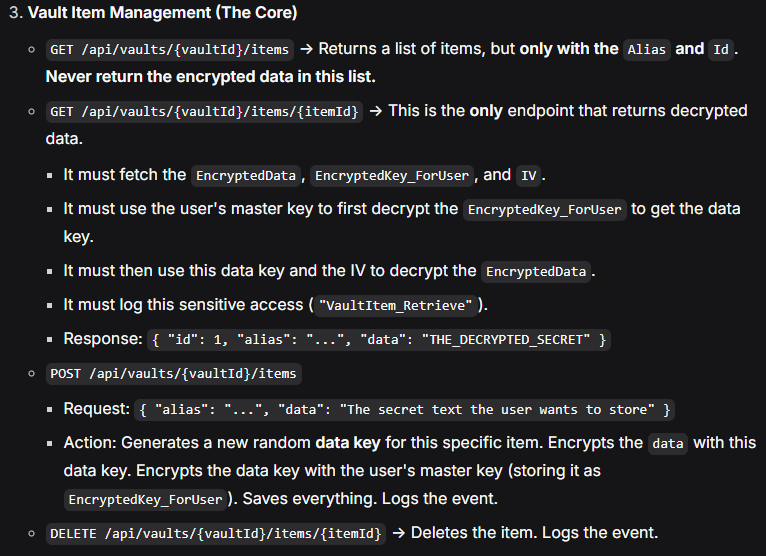
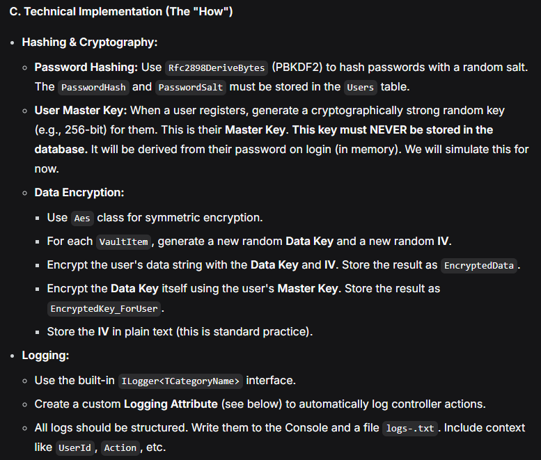
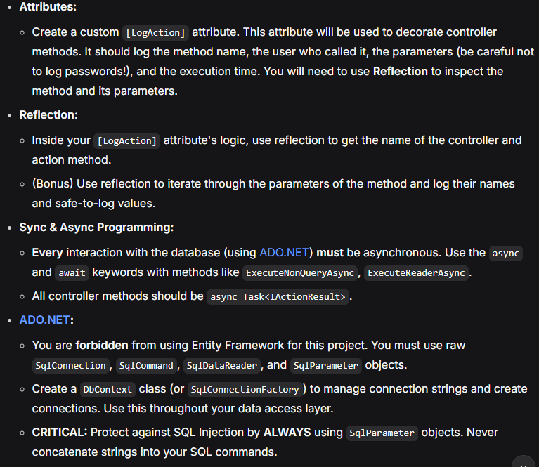
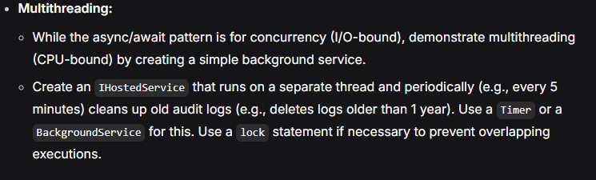
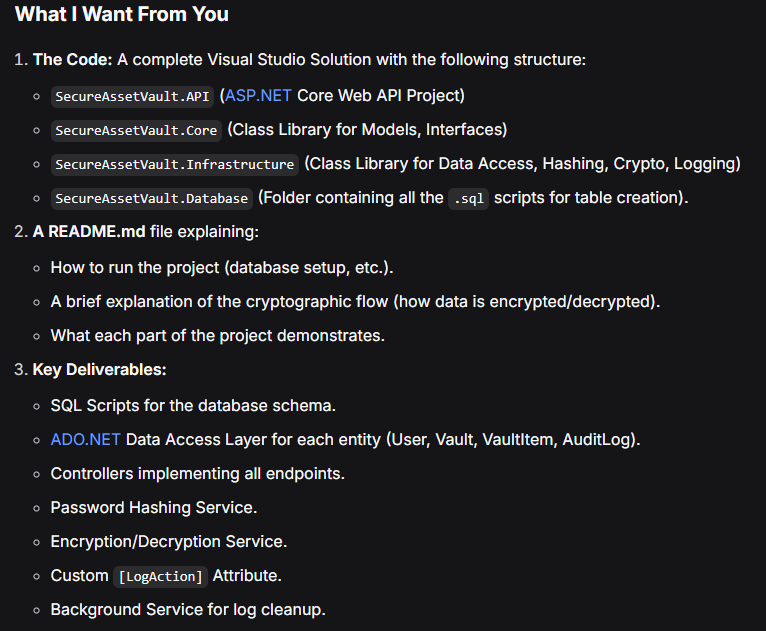

# Secure Asset Vault

## 📖 Overview

This project is a **controller‑based RESTful API** built with **ASP.NET Core**.  
The application follows a **3‑tier architecture**:  

- **API** - Controllers that contain API endpoints.
- **CORE** - Services, DTOs, Utilities and application rules.
- **DataAccess** - Repositories and Models (SQL Server).

The core purpose of this project is to demonstrate **secure handling of sensitive string data** (e.g., secrets, tokens, passwords, etc...).  

>**Note:** ⚠️ It is created for **learning and educational purposes** to practice backend fundamentals and clean architecture using .NET Ecosystem.

---

## 📋 Requirements











---

## 🚀 Features

- Dependency Injection (DI) for services and repositories.
- Authentication & Authorization with **JWT (JSON Web Tokens)**.
- API documentation with **Swagger**.
- T‑SQL & Transactions.
- Automatic Controller Action Logging via Attributes.
- Structured Logging with Serilog.
- Background Services (log cleanup).
- Async Programming & Multithreading for scalability.
- Input Validation & Error Handling.
- Encryption/Decryption & Hashing.

---

## 🛠️ Tech Stack

- **Data Access:** ADO.NET with SQL Server.
- **Database Scripts:** T‑SQL (stored procedures, Transactions).
- **Background Services:** IHostedService (log cleanup).
- **Framework:** ASP.NET Core 8.0 (Controller‑based REST API).
- **Architecture:** 3‑tier (API, Core, DataAccess).

---

## 📦 Prerequisites

- **.NET SDK** (v8.0).
- **SQL Server**.

---

## 📂 Project Structure

```plaintext
SecureAssetVault/  
├── API/                     # Presentation layer (controllers, startup, swagger)  
│   ├── Controllers/  
│   ├── Logs/  
│   │   └── logs-.txt  
│   ├── appsettings.json  
│   └── Program.cs  

├── Core/                    # Business logic layer  
│   │   Interfaces/  
│   ├── Requests/  
│   ├── Responses/  
│   ├── Services/  
│   └── Utilities/  
│       ├── Attributes/  
│       │   └── LogActionAttribute.cs  
│       ├── Filters/  
│       │   └── LogActionFilter.cs  
│       └── Services/  
│           ├── AuditLogsCleanService.cs  
│           ├── EncryptionService.cs  
│           ├── HashService.cs  
│           └── JwtService.cs  

├── DataAccess/              # Persistence layer  
│   ├── Interfaces/  
│   ├── Models/  
│   └── Repositories/  

├── Database/                # SQL scripts  
│   ├── DatabaseCreation.sql  
│   ├── UserSp.sql  
│   └── VaultSP.sql  

├── Requirements/            # Requirement images (9 .png)

└── README.md  

└── .gitignore  

└── Secure Asset Vault.sln  
```

---

## ⚙️ Installation

1. **Clone the repository**

   ```bash
   git clone https://github.com/Baraa-Mansour/Secure-Asset-Vaults-API.git
   cd SecureAssetVault
   ```

2. **Restore dependencies**

   ```bash
   dotnet restore
   ```

3. **Create Database**

   -Open SQL Server -> new query -> put the next command:

   ```bash
   CREATE DATABASE AssetVault;
   ```

   -Navigate to the `/Database` folder in the repository and run the scripts in order:  
   1. DatabaseCreation.sql
   2. UserSp.sql
   3. VaultSP.sql  

   >**Note:** These scripts must be executed inside the **AssetVault** database created in **step 3**.
4. **Configure the database**  

    Update the connection string in appsettings.json (inside SecureAssetVault.API) to match your SQL Server instance.
5. **Run the application**

    ```bash
    dotnet run --project API
    ```

6. **Access Swagger UI**

    -Once running, open your browser at:

    ```bash
    http://localhost:<Port>/swagger
    ```

    -Replace `<port>` with the port shown in your console output, By default, it may run on *5062*.

---

## 🔗 API Endpoints

### 🧑 Authentication (/api/auth)

POST /api/auth/register → Register a new user  
POST /api/auth/login → Login with username/email + password, returns JWT

### 🔐 Vaults (/api/vaults)

GET /api/vaults → Get all vaults for the authenticated user  
POST /api/vaults → Create a new vault for the authenticated user  
PUT /api/vaults/{vaultId} → Update an existing vault by ID  
DELETE /api/vaults/{vaultId} → Delete a vault by ID

### 📦 Vault Items (/api/vaults/{vaultId}/items)

GET /api/vaults/{vaultId}/items → Get all items in a vault for the authenticated user  
GET /api/vaults/{vaultId}/items/{itemId} → Get a specific vault item by ID  
POST /api/vaults/{vaultId}/items → Create a new item inside a vault  
DELETE /api/vaults/{vaultId}/items/{itemId} → Delete a vault item by ID

### 🔹 Notes

- All Vaults and Vault Items endpoints require JWT authentication (`Authorization: Bearer <token>`).

- Swagger UI `http://localhost:<Port>/swagger` provides interactive documentation and testing.

---
